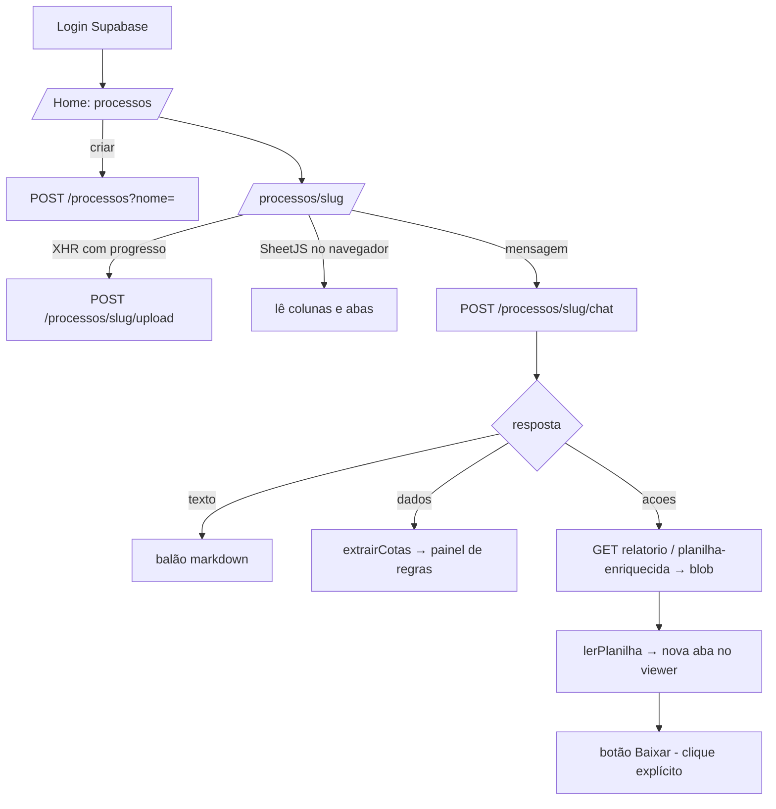

# Ranking — Front-end (`ranking-frontend`) — Documentação técnica e funcional

> Repositório: `tecnologiact/ranking-frontend`. Interface web (Next.js 14, App Router, JavaScript) do sistema de **Ranking de candidatos** da Cia de Talentos. É um **chat-centrado**: o analista sobe uma planilha, conversa com a IA do `beckend-ranking` para configurar regras e rodar o ranking, e vê planilhas e relatórios como **abas** dentro da tela. Escrito para que alguém que nunca viu o sistema consiga **recriá-lo do zero**. O contrato com o backend está descrito em `beckend-ranking` (seção 8 e Apêndice 11.1).

## 1. O que é e para quem serve
Usuário: analista de R&S da CT (login Supabase Auth). Telas:
| Rota | Função |
|---|---|
| `/login` | Login e-mail/senha (Supabase Auth); painel vermelho da marca à esquerda. |
| `/` | Lista de **processos** (do Cérebro) e criação/exclusão de processo. |
| `/processos/[slug]` | **Workspace**: upload do Excel, lista de uploads, chat com a IA, visualizador de planilhas em abas, conversas anteriores, cotas/regras espelhadas, exportação. |
| `/processos/[slug]/resultado/[uploadId]` | Tela legada de **resultado por vaga** (aprovar vaga/tudo, mover candidato, baixar relatório). |

## 2. Glossário
| Termo | Significado |
|---|---|
| **Processo (slug)** | Programa de recrutamento (ex.: `bracell_2026`). |
| **Upload** | Arquivo Excel enviado; o chat é sempre escopado por `upload_id`. |
| **Ação** | Instrução devolvida pelo chat (`download_relatorio`, `download_planilha_enriquecida`) que o front executa abrindo o arquivo **como nova aba** (sem baixar). |
| **Doc / aba** | Planilha aberta no `SpreadsheetViewer` (original, relatório de cenário, resultado da IA). |
| **ranking pronto** | Estado local que libera o botão "Exportar" só depois que o chat gerou um relatório/planilha de verdade. |

## 3. Fluxos

Reconstrução em outro computador: se o cache local (IndexedDB) está vazio, o workspace busca `planilha-enriquecida` (planilha original) e `cenarios-gerados` + `relatorio?cenario=` (abas de cenário) no servidor.

## 4. Arquitetura, stack e arquivos
- **Next.js 14 (App Router, client components), React 18, `@supabase/supabase-js`, `react-markdown`, `xlsx` (SheetJS, carregado sob demanda)**; CSS Modules + `globals.css` (identidade CT, vermelho). Sem TypeScript.
- `next.config.js`: *rewrite* `/api/proxy/:path*` → `NEXT_PUBLIC_API_URL/:path*` (evita CORS em dev).
- `lib/api.js`: cliente HTTP com Bearer do Supabase (em `localhost` usa `/api/proxy`); `lib/supabase.js`; `lib/parseExcel.js` (colunas e grid); `lib/docCache.js` (IndexedDB `ranking_docs_cache`); `lib/useToast.js`; `lib/auth.js` (obsoleto, vazio).
- Componentes: `ChatPanel` (chat + sugestões + regras), `SpreadsheetViewer`, `UploadArea`, `VagasTable`, `Header`, `Toast`.
- `resultado-page.js` na raiz é um arquivo solto, diferente da tela de resultado em `app/…/resultado/[uploadId]/page.js` (não é rota).

## 5. Variáveis de ambiente (Vercel)
| Variável | Uso |
|---|---|
| `NEXT_PUBLIC_API_URL` | URL do `beckend-ranking` (EasyPanel). |
| `NEXT_PUBLIC_SUPABASE_URL` | Projeto Supabase compartilhado. |
| `NEXT_PUBLIC_SUPABASE_ANON_KEY` | Chave pública (anon) para login. |

## 6. Estado e persistência no navegador
| Chave | Onde | Conteúdo / validade |
|---|---|---|
| `chat_id_<slug>_<uploadId>` | `localStorage` | `{chatId, savedAt}` — expira em **15 dias**. |
| `ranking_pronto_<slug>_<uploadId>` | `localStorage` | libera exportação. |
| `ranking_docs_cache` / `docs` | IndexedDB | abas de planilha abertas por upload (o backend **não guarda o arquivo bruto**). |
Não há banco próprio; todo dado de negócio vem da API.

## 7. Autenticação
`supabase.auth.signInWithPassword`; páginas verificam `getSession()` e redirecionam a `/login`. Cada chamada pega `access_token` da sessão e envia `Authorization: Bearer`. Não há distinção de papéis na interface.

## 8. Contrato consumido (resumo de `lib/api.js`)
`listarProcessos`, `criarProcesso(nome)`, `deletarProcesso(slug)`, `listarUploads`, `deletarUpload`, `uploadArquivoComProgresso` (XHR, sem timeout), `enviarMensagemChat`, `listarConversas`, `obterConversa`, `listarCenariosGerados`, `baixarRelatorio`, `baixarPlanilhaEnriquecida`, `blobDaAcao`, `obterResultado`, `aprovarVaga`, `aprovarTudo`, `moverCandidato`. Detalhes dos endpoints: documentação do backend.

## 9. Regras de negócio na interface
- **Configurar e rodar só pelo chat**; o painel lateral é um *espelho* (arquivo, colunas detectadas, cotas/regras).
- Ações do chat **nunca baixam sozinhas**: abrem aba; o download é clique explícito (`baixar:true`). Erros de ação aparecem na conversa (não silenciosos).
- Tipos de ação desconhecidos são ignorados com `console.warn`.
- Cotas renderizadas pelas **strings** `cotas_descricoes`, nunca pelos objetos.
- Chips de sugestão guiam os fluxos (explicar coluna, cotas, priorizar por nota, repescagem, pesos de assessment, estudo de flexibilização).
- O viewer limita a **5.000 linhas** por aba (`maxRows`) e mostra aviso de truncamento.
- Cenários A/B/C deixaram de ser escolha do usuário; a estratégia vem das regras conversadas.

## 10. Roteiro para recriar e checklist
1. `npx create-next-app` (JS, App Router) com as dependências do `package.json`; alias `@/` em `jsconfig.json`.
2. Configurar as 3 variáveis; `lib/supabase.js`; `lib/api.js` (código nos apêndices).
3. Implementar login, home, workspace (upload + chat + viewer) e resultado.
4. Backend `beckend-ranking` acessível e com CORS liberando a origem do front.
5. Deploy na Vercel; conferir `NEXT_PUBLIC_API_URL`.
6. Teste: login → criar processo → subir Excel (barra de progresso) → pedir "analise a base" → aba de relatório → baixar.

**Checklist**: [ ] URL da API em produção · [ ] body ≥ 50 MB no servidor · [ ] cache IndexedDB funcionando · [ ] abas reconstruídas em outro navegador.

## 11. Apêndices — código-fonte real
### 11.1 `lib/api.js`
```javascript
import { supabase } from "./supabase";

// Em dev, usa proxy do Next.js para evitar CORS. Em prod, chama direto.
const IS_DEV =
  typeof window !== "undefined" && window.location.hostname === "localhost";
const API_URL = IS_DEV ? "/api/proxy" : process.env.NEXT_PUBLIC_API_URL;

async function getToken() {
  const {
    data: { session },
  } = await supabase.auth.getSession();
  const token = session?.access_token;
  if (!token) throw new Error("Usuário não autenticado. Faça login.");
  return token;
}

async function request(path, options = {}) {
  const token = await getToken();
  const headers = { ...options.headers };
  headers["Authorization"] = `Bearer ${token}`;
  if (!(options.body instanceof FormData) && !headers["Content-Type"]) {
    headers["Content-Type"] = "application/json";
  }
  const res = await fetch(`${API_URL}${path}`, { ...options, headers });
  if (!res.ok) {
    const text = await res.text().catch(() => "");
    let detail;
    try {
      detail = JSON.parse(text)?.detail;
    } catch {
      detail = text;
    }
    throw new Error(detail || `Erro ${res.status}`);
  }
  return res;
}

async function json(path, options) {
  const res = await request(path, options);
  return res.json();
}

// --- Processos ---

export async function listarProcessos() {
  return json("/processos");
}

export async function criarProcesso(nome) {
  return json(`/processos?nome=${encodeURIComponent(nome)}`, { method: "POST" });
}

export async function deletarProcesso(slug) {
  return json(`/processos/${slug}`, { method: "DELETE" });
}

// --- Uploads ---

export async function listarUploads(slug) {
  return json(`/processos/${slug}/uploads`);
}

export async function deletarUpload(uploadId) {
  return json(`/uploads/${uploadId}`, { method: "DELETE" });
}

// Upload com barra de progresso e sem timeout artificial — suporta arquivos
// grandes (12MB+, ~35MB). Usa XHR porque fetch não expõe progresso de upload.
export function uploadArquivoComProgresso(slug, arquivo, onProgress) {
  return new Promise(async (resolve, reject) => {
    let token;
    try {
      token = await getToken();
    } catch (e) {
      return reject(e);
    }
    const formData = new FormData();
    formData.append("arquivo", arquivo);

    const xhr = new XMLHttpRequest();
    xhr.open("POST", `${API_URL}/processos/${slug}/upload`);
    xhr.setRequestHeader("Authorization", `Bearer ${token}`);
    xhr.upload.onprogress = (e) => {
      if (!onProgress) return;
      onProgress(e.lengthComputable ? Math.round((e.loaded / e.total) * 100) : null);
    };
    xhr.onload = () => {
      if (xhr.status >= 200 && xhr.status < 300) {
        try {
          resolve(xhr.responseText ? JSON.parse(xhr.responseText) : {});
        } catch {
          resolve({});
        }
      } else {
        let detail;
        try {
          detail = JSON.parse(xhr.responseText)?.detail;
        } catch {
          detail = xhr.responseText;
        }
        reject(new Error(detail || `Erro ${xhr.status} ao enviar o arquivo.`));
      }
    };
    xhr.onerror = () =>
      reject(new Error("Erro de rede ao enviar o arquivo. Tente novamente."));
    xhr.send(formData);
  });
}

// --- Chat (CHAT_CONTRACT.md) ---
// Retorna { chat_id, resposta, ferramentas_usadas, dados, acoes }.
// Configurar regras e rodar ranking é SÓ por aqui — não há rota manual.
export async function enviarMensagemChat(slug, { mensagem, chat_id, upload_id }) {
  const body = { mensagem };
  if (chat_id) body.chat_id = chat_id;
  if (upload_id) body.upload_id = upload_id;
  return json(`/processos/${slug}/chat`, {
    method: "POST",
    body: JSON.stringify(body),
  });
}

// Lista as conversas existentes de um upload (mais recente primeiro):
// [{ id, nome, criado_em }]
export async function listarConversas(slug, uploadId) {
  return json(`/processos/${slug}/upload/${uploadId}/chats`);
}

// Retoma uma conversa específica: { chat_id, msgs: [{role, content}] }
export async function obterConversa(slug, chatId) {
  return json(`/processos/${slug}/chats/${chatId}`);
}

// --- Downloads autenticados (blob) ---
// baixar:false (padrão vindo do chat) → só busca o blob pra mostrar como aba.
// baixar:true → clique explícito do analista, salva o arquivo no computador.
export async function baixarArquivoAutenticado(caminho, nomeArquivo, { baixar = true } = {}) {
  const res = await request(caminho);
  const blob = await res.blob();
  if (baixar && typeof window !== "undefined") {
    const url = window.URL.createObjectURL(blob);
    const a = document.createElement("a");
    a.href = url;
    a.download = nomeArquivo;
    document.body.appendChild(a);
    a.click();
    a.remove();
    window.URL.revokeObjectURL(url);
  }
  return blob;
}

// Lista os cenários (A/B/C ou nome customizado) já rodados pra este upload,
// mais recente primeiro: [{ cenario, gerado_em }]. Persistido no servidor
// (ranking_gerados) - usado pra reconstruir as abas "Relatório · cenário X"
// quando um analista abre o upload num computador diferente de quem rodou
// o ranking (mesmo problema que a planilha original tinha).
export async function listarCenariosGerados(slug, uploadId) {
  return json(`/processos/${slug}/upload/${uploadId}/cenarios-gerados`);
}

export async function baixarRelatorio({ processo, upload_id, cenario }, opcoes) {
  const qs = cenario ? `?cenario=${encodeURIComponent(cenario)}` : "";
  return baixarArquivoAutenticado(
    `/processos/${processo}/upload/${upload_id}/relatorio${qs}`,
    `relatorio_${processo}_${String(upload_id).slice(0, 8)}${cenario ? "_cenario_" + cenario : ""}.xlsx`,
    opcoes
  );
}

export async function baixarPlanilhaEnriquecida({ processo, upload_id }, opcoes) {
  return baixarArquivoAutenticado(
    `/processos/${processo}/upload/${upload_id}/planilha-enriquecida`,
    `planilha_enriquecida_${processo}_${String(upload_id).slice(0, 8)}.xlsx`,
    opcoes
  );
}

// Nome amigável default por tipo de ação (usado no rótulo da aba e no download).
export function nomeArquivoDaAcao(acao) {
  const p = acao?.params || {};
  const up = String(p.upload_id || "").slice(0, 8);
  if (acao?.tipo === "download_relatorio") {
    return `relatorio_${p.processo}_${up}${p.cenario ? "_cenario_" + p.cenario : ""}.xlsx`;
  }
  if (acao?.tipo === "download_planilha_enriquecida") {
    return `planilha_enriquecida_${p.processo}_${up}.xlsx`;
  }
  return "arquivo.xlsx";
}

// Busca o blob de uma ação do chat (sempre baixar:false — só pra mostrar aba).
// baixar:true é usado no clique explícito do analista.
export async function blobDaAcao(acao, { baixar = false } = {}) {
  if (acao?.tipo === "download_relatorio") {
    return baixarRelatorio(acao.params, { baixar });
  }
  if (acao?.tipo === "download_planilha_enriquecida") {
    return baixarPlanilhaEnriquecida(acao.params, { baixar });
  }
  throw new Error(`Ação desconhecida: ${acao?.tipo}`);
}

// --- Resultado / aprovação / movimentação (ainda existem na API) ---

export async function obterResultado(slug, uploadId, vaga) {
  return json(`/processos/${slug}/resultado/${uploadId}/${vaga}`);
}

export async function aprovarVaga(slug, uploadId, vaga) {
  return json(`/processos/${slug}/upload/${uploadId}/vaga/${vaga}/aprovar`, {
    method: "POST",
  });
}

export async function aprovarTudo(slug, uploadId) {
  return json(`/processos/${slug}/upload/${uploadId}/aprovar-tudo`, {
    method: "POST",
  });
}

export async function moverCandidato(slug, uploadId, { candidato_codigo, vaga_destino, motivo }) {
  const params = new URLSearchParams({
    candidato_codigo: String(candidato_codigo),
    vaga_destino: String(vaga_destino),
    motivo,
  });
  return json(`/processos/${slug}/upload/${uploadId}/mover-candidato?${params}`, {
    method: "POST",
  });
}
```
### 11.2 `lib/parseExcel.js` e `lib/docCache.js`
```javascript
// Leitura das colunas do arquivo direto no navegador (sem depender do backend).
// Extrai as abas e os cabeçalhos de cada uma para o analista explicar ao chat
// quais colunas existem e como devem ser usadas (item 1 da evolução).
// O SheetJS (xlsx) é pesado, então é carregado sob demanda (dynamic import)
// só quando um arquivo é de fato parseado — mantém o bundle inicial leve.

const VAGA_RE = /vaga/i;
const CAND_RE = /candidat|base|dados|inscri/i;

function headersFromSheet(XLSX, ws) {
  if (!ws) return [];
  // header:1 → primeira linha como array de títulos. defval evita buracos.
  const rows = XLSX.utils.sheet_to_json(ws, { header: 1, blankrows: false, defval: "" });
  const first = rows[0] || [];
  return first
    .map((h) => (h == null ? "" : String(h).trim()))
    .filter((h) => h.length > 0);
}

/**
 * Lê um File (.xlsx/.xls/.csv) e devolve as abas e colunas detectadas.
 * Faz uma leitura limitada de linhas (sheetRows) para ser rápido mesmo em
 * arquivos grandes — só precisamos dos cabeçalhos.
 * @returns {Promise<{sheets: {name:string, headers:string[]}[], candidatosSheet: string|null, vagasSheet: string|null, colunas: string[], colunasVagas: string[]}>}
 */
export async function lerColunasDoArquivo(file) {
  const XLSX = await import("xlsx");
  const buf = await file.arrayBuffer();
  const wb = XLSX.read(buf, {
    type: "array",
    sheetRows: 5, // só as primeiras linhas: basta pro cabeçalho
    cellFormula: false,
    cellHTML: false,
    cellStyles: false,
  });

  const sheets = wb.SheetNames.map((name) => ({
    name,
    headers: headersFromSheet(XLSX, wb.Sheets[name]),
  })).filter((s) => s.headers.length > 0);

  // Heurística: aba de vagas casa /vaga/i; candidatos é a primeira que não é vaga,
  // ou a com mais colunas.
  const vagas = sheets.find((s) => VAGA_RE.test(s.name)) || null;
  const naoVagas = sheets.filter((s) => s !== vagas);
  const candidatos =
    naoVagas.find((s) => CAND_RE.test(s.name)) ||
    naoVagas.slice().sort((a, b) => b.headers.length - a.headers.length)[0] ||
    sheets[0] ||
    null;

  return {
    sheets,
    candidatosSheet: candidatos?.name || null,
    vagasSheet: vagas?.name || null,
    colunas: candidatos?.headers || [],
    colunasVagas: vagas?.headers || [],
  };
}

/**
 * Lê um File OU Blob (.xlsx/.csv) completo para exibir num grid.
 * Devolve as abas com colunas + linhas (array de arrays), com corte de linhas
 * pra não travar o navegador em bases enormes.
 * @returns {Promise<{sheets: {name:string, columns:string[], rows:any[][], totalRows:number, truncated:boolean}[]}>}
 */
export async function lerPlanilha(fileOrBlob, { maxRows = 5000 } = {}) {
  const XLSX = await import("xlsx");
  const buf = await fileOrBlob.arrayBuffer();
  const wb = XLSX.read(buf, {
    type: "array",
    sheetRows: maxRows + 1, // cabeçalho + maxRows de dados
    cellFormula: false,
    cellHTML: false,
    cellStyles: false,
  });

  const sheets = wb.SheetNames.map((name) => {
    const ws = wb.Sheets[name];
    const aoa = XLSX.utils.sheet_to_json(ws, {
      header: 1,
      blankrows: false,
      defval: "",
    });
    const columns = (aoa[0] || []).map((h) => (h == null ? "" : String(h)));
    const rows = aoa.slice(1);
    const truncated = rows.length >= maxRows;
    return { name, columns, rows, totalRows: rows.length, truncated };
  }).filter((s) => s.columns.length > 0 || s.rows.length > 0);

  return { sheets };
}

// ---- lib/docCache.js ----
// Cache client-side (IndexedDB) das abas de planilha abertas por upload.
// O back-end não guarda o arquivo bruto nem o estado do viewer — só a
// conversa — então sem isso a planilha some ao sair e voltar da tela.
const DB_NAME = "ranking_docs_cache";
const STORE = "docs";

function openDb() {
  return new Promise((resolve, reject) => {
    const req = indexedDB.open(DB_NAME, 1);
    req.onupgradeneeded = () => {
      req.result.createObjectStore(STORE);
    };
    req.onsuccess = () => resolve(req.result);
    req.onerror = () => reject(req.error);
  });
}

export async function saveDocsCache(key, docs) {
  if (typeof window === "undefined" || !window.indexedDB) return;
  try {
    const db = await openDb();
    await new Promise((resolve, reject) => {
      const tx = db.transaction(STORE, "readwrite");
      tx.objectStore(STORE).put({ docs, savedAt: Date.now() }, key);
      tx.oncomplete = () => resolve();
      tx.onerror = () => reject(tx.error);
    });
    db.close();
  } catch {}
}

export async function loadDocsCache(key) {
  if (typeof window === "undefined" || !window.indexedDB) return null;
  try {
    const db = await openDb();
    const result = await new Promise((resolve, reject) => {
      const tx = db.transaction(STORE, "readonly");
      const req = tx.objectStore(STORE).get(key);
      req.onsuccess = () => resolve(req.result || null);
      req.onerror = () => reject(req.error);
    });
    db.close();
    return Array.isArray(result?.docs) ? result.docs : null;
  } catch {
    return null;
  }
}

export async function clearDocsCache(key) {
  if (typeof window === "undefined" || !window.indexedDB) return;
  try {
    const db = await openDb();
    await new Promise((resolve, reject) => {
      const tx = db.transaction(STORE, "readwrite");
      tx.objectStore(STORE).delete(key);
      tx.oncomplete = () => resolve();
      tx.onerror = () => reject(tx.error);
    });
    db.close();
  } catch {}
}
```
### 11.3 Workspace — `app/processos/[slug]/page.js`
```javascript
"use client";

import { useState, useEffect, useMemo, useCallback } from "react";
import { useRouter } from "next/navigation";
import {
  listarUploads,
  uploadArquivoComProgresso,
  deletarUpload,
  enviarMensagemChat,
  listarConversas,
  obterConversa,
  blobDaAcao,
  baixarPlanilhaEnriquecida,
  baixarRelatorio,
  listarCenariosGerados,
} from "@/lib/api";
import { lerPlanilha } from "@/lib/parseExcel";
import { saveDocsCache, loadDocsCache } from "@/lib/docCache";
import { useToast } from "@/lib/useToast";
import UploadArea from "@/components/UploadArea/UploadArea";
import ChatPanel from "@/components/ChatPanel/ChatPanel";
import SpreadsheetViewer from "@/components/SpreadsheetViewer/SpreadsheetViewer";

// -------- persistência local (chat_id por upload) --------
const TTL_MS = 15 * 24 * 60 * 60 * 1000;
function chatIdKey(slug, uploadId) {
  return `chat_id_${slug}_${uploadId}`;
}
function saveChatId(slug, uploadId, chatId) {
  if (typeof window === "undefined") return;
  try {
    window.localStorage.setItem(
      chatIdKey(slug, uploadId),
      JSON.stringify({ chatId, savedAt: Date.now() })
    );
  } catch {}
}
function loadChatId(slug, uploadId) {
  if (typeof window === "undefined") return null;
  try {
    const raw = window.localStorage.getItem(chatIdKey(slug, uploadId));
    if (!raw) return null;
    const p = JSON.parse(raw);
    if (!p?.savedAt || Date.now() - p.savedAt > TTL_MS) return null;
    return p.chatId || null;
  } catch {
    return null;
  }
}

// -------- persistência local (gatilho de exportação por upload) --------
// A exportação só libera depois que o ranking rodou de verdade (o chat
// devolveu um relatório/planilha enriquecida) — guarda isso por upload pra
// não perder o estado ao trocar de tela.
function rankingProntoKey(slug, uploadId) {
  return `ranking_pronto_${slug}_${uploadId}`;
}
function saveRankingPronto(slug, uploadId) {
  if (typeof window === "undefined") return;
  try {
    window.localStorage.setItem(rankingProntoKey(slug, uploadId), "1");
  } catch {}
}
function loadRankingPronto(slug, uploadId) {
  if (typeof window === "undefined") return false;
  try {
    return window.localStorage.getItem(rankingProntoKey(slug, uploadId)) === "1";
  } catch {
    return false;
  }
}

// Detecta colunas de candidatos/vagas a partir das abas já parseadas.
function detectarColunas(sheets = []) {
  const vaga = sheets.find((s) => /vaga/i.test(s.name)) || null;
  const naoVaga = sheets.filter((s) => s !== vaga);
  const cand =
    naoVaga.find((s) => /candidat|base|dados|inscri/i.test(s.name)) ||
    naoVaga.slice().sort((a, b) => b.columns.length - a.columns.length)[0] ||
    sheets[0] ||
    null;
  return {
    colunas: cand?.columns || [],
    colunasVagas: vaga?.columns || [],
  };
}

// Rótulo amigável para a aba gerada por uma ação do chat.
function rotuloAcao(acao) {
  if (acao?.tipo === "download_relatorio") {
    return `Relatório${acao.params?.cenario ? " · cenário " + acao.params.cenario : ""}`;
  }
  if (acao?.tipo === "download_planilha_enriquecida") {
    return "Planilha enriquecida";
  }
  return "Documento";
}

// Extrai descrições de cotas de qualquer payload de `dados` (pra mostrar o
// estado atual de configuração — já que /regras não existe mais).
function extrairCotas(dados) {
  const out = [];
  const visit = (obj) => {
    if (!obj || typeof obj !== "object") return;
    if (Array.isArray(obj.cotas_descricoes)) out.push(...obj.cotas_descricoes);
    for (const v of Object.values(obj)) {
      if (v && typeof v === "object") visit(v);
    }
  };
  (Array.isArray(dados) ? dados : []).forEach((d) => visit(d));
  return Array.from(new Set(out));
}

export default function ProcessoPage({ params }) {
  const { slug } = params;
  const router = useRouter();
  const { addToast } = useToast();

  const [uploads, setUploads] = useState([]);
  const [activeUpload, setActiveUpload] = useState(null);
  const [uploading, setUploading] = useState(false);
  const [uploadProgress, setUploadProgress] = useState(null);
  const [loadingPage, setLoadingPage] = useState(true);

  // Chat
  const [chatId, setChatId] = useState(null);
  const [messages, setMessages] = useState([]);
  const [chatLoading, setChatLoading] = useState(false);

  // Conversas do upload
  const [conversas, setConversas] = useState([]);
  const [conversasOpen, setConversasOpen] = useState(false);

  // Documentos do viewer (planilha do upload + gerados pela IA)
  const [docs, setDocs] = useState([]);
  const [activeDocId, setActiveDocId] = useState(null);

  // Cotas/estado atual (derivado de `dados` do chat)
  const [cotas, setCotas] = useState([]);

  // Colunas detectadas (pra sugestões do chat)
  const [colunas, setColunas] = useState([]);

  const uploadId = activeUpload?.id || activeUpload?.upload_id || null;
  const [exportando, setExportando] = useState(false);

  // Gatilho: exportar só libera depois que o ranking rodou de verdade.
  const [rankingPronto, setRankingPronto] = useState(false);

  async function fetchUploads() {
    try {
      const data = await listarUploads(slug);
      setUploads(Array.isArray(data) ? data : []);
    } catch (err) {
      addToast(err.message, "error");
    } finally {
      setLoadingPage(false);
    }
  }

  useEffect(() => {
    fetchUploads();
    // eslint-disable-next-line react-hooks/exhaustive-deps
  }, [slug]);

  // Ao ativar um upload: carrega conversas, retoma a última (se houver) e
  // restaura o gatilho de exportação salvo pra esse upload.
  useEffect(() => {
    if (!uploadId) return;
    setRankingPronto(loadRankingPronto(slug, uploadId));
    let cancelled = false;

    (async () => {
      try {
        const lista = await listarConversas(slug, uploadId);
        if (!cancelled) setConversas(Array.isArray(lista) ? lista : []);
        const salvo = loadChatId(slug, uploadId);
        const alvo = salvo || (Array.isArray(lista) && lista[0]?.id) || null;
        if (alvo) await abrirConversa(alvo, { silencioso: true });
      } catch (e) {
        // sem conversas ainda — tudo bem
      }
    })();

    return () => {
      cancelled = true;
    };
    // eslint-disable-next-line react-hooks/exhaustive-deps
  }, [uploadId]);

  // Reabrir um upload (via lista ou retomada de sessão) perde o arquivo/abas
  // em memória — restaura do cache local (IndexedDB) primeiro; se não achar
  // (outro navegador/sessão - ex: outro analista abrindo o mesmo upload),
  // reconstrói tudo a partir do que está salvo no servidor: a planilha
  // original (via planilha-enriquecida) E cada relatório de cenário já
  // rodado (via cenarios-gerados + relatorio). Sem isso, essas abas só
  // existiam no navegador de quem as gerou originalmente.
  useEffect(() => {
    if (!uploadId || docs.length > 0) return;
    let cancelled = false;
    (async () => {
      const cacheKey = `${slug}:${uploadId}`;
      const cached = await loadDocsCache(cacheKey);
      if (cancelled) return;
      if (cached && cached.length) {
        setDocs(cached);
        setActiveDocId(cached[0]?.id || null);
        const base = cached.find((d) => d.kind === "upload") || cached[0];
        if (base?.sheets?.length) {
          const det = detectarColunas(base.sheets);
          setColunas((prev) => (prev.length ? prev : det.colunas));
        }
        return;
      }

      const reconstruidos = [];

      try {
        const blob = await baixarPlanilhaEnriquecida({ processo: slug, upload_id: uploadId }, { baixar: false });
        const parsed = await lerPlanilha(blob);
        if (parsed.sheets.length) {
          const det = detectarColunas(parsed.sheets);
          setColunas((prev) => (prev.length ? prev : det.colunas));
          reconstruidos.push({
            id: "upload",
            label: activeUpload?.filename || activeUpload?.arquivo_nome || activeUpload?.nome || "Planilha",
            kind: "upload",
            sheets: parsed.sheets,
          });
        }
      } catch (e) {
        // Ainda não há planilha pra este upload — segue sem essa aba.
      }

      try {
        const cenarios = await listarCenariosGerados(slug, uploadId);
        for (const { cenario } of cenarios || []) {
          const acao = { tipo: "download_relatorio", params: { processo: slug, upload_id: uploadId, cenario } };
          try {
            const blob = await baixarRelatorio(acao.params, { baixar: false });
            const parsed = await lerPlanilha(blob);
            reconstruidos.push({
              id: `cenario-${cenario}`,
              label: rotuloAcao(acao),
              kind: "gerado",
              downloadAcao: acao,
              sheets: parsed.sheets,
            });
          } catch (e) {
            // Esse cenário específico falhou ao reconstruir - segue pros outros.
          }
        }
        if (cenarios?.length) {
          setRankingPronto(true);
          saveRankingPronto(slug, uploadId);
        }
      } catch (e) {
        // Sem cenários gerados ainda, ou rota indisponível - segue sem essas abas.
      }

      if (cancelled || !reconstruidos.length) return;
      setDocs(reconstruidos);
      setActiveDocId(reconstruidos[0].id);
    })();
    return () => {
      cancelled = true;
    };
    // eslint-disable-next-line react-hooks/exhaustive-deps
  }, [uploadId]);

  // Sempre que as abas do viewer mudam, persiste no cache local — é o que
  // garante que a planilha continue aberta ao sair e voltar pra tela.
  useEffect(() => {
    if (!uploadId || !docs.length) return;
    saveDocsCache(`${slug}:${uploadId}`, docs);
  }, [docs, uploadId, slug]);

  const abrirConversa = useCallback(
    async (cId, { silencioso = false } = {}) => {
      try {
        const conv = await obterConversa(slug, cId);
        setChatId(conv.chat_id || cId);
        setMessages(Array.isArray(conv.msgs) ? conv.msgs : []);
        saveChatId(slug, uploadId, conv.chat_id || cId);
        setConversasOpen(false);
      } catch (err) {
        if (!silencioso) addToast(err.message, "error");
      }
    },
    // eslint-disable-next-line react-hooks/exhaustive-deps
    [slug, uploadId]
  );

  function novaConversa() {
    setChatId(null);
    setMessages([]);
    setConversasOpen(false);
    if (uploadId && typeof window !== "undefined") {
      window.localStorage.removeItem(chatIdKey(slug, uploadId));
    }
  }

  async function handleUpload(file) {
    setUploading(true);
    setUploadProgress(0);

    // Parse do arquivo pro viewer (client-side, uma vez).
    let parsed = { sheets: [] };
    try {
      parsed = await lerPlanilha(file);
    } catch (e) {
      console.warn("Falha ao ler a planilha:", e);
    }

    try {
      const result = await uploadArquivoComProgresso(slug, file, setUploadProgress);
      const det = detectarColunas(parsed.sheets);
      setColunas(det.colunas);
      setDocs(
        parsed.sheets.length
          ? [{ id: "upload", label: file.name, kind: "upload", sheets: parsed.sheets }]
          : []
      );
      setActiveDocId(parsed.sheets.length ? "upload" : null);
      setMessages([]);
      setChatId(null);
      setCotas([]);
      setRankingPronto(false);
      addToast("Arquivo enviado com sucesso!", "success");
      setActiveUpload(result);
    } catch (err) {
      addToast(err.message, "error");
    } finally {
      setUploading(false);
      setUploadProgress(null);
      fetchUploads();
    }
  }

  async function handleDeleteUpload(uId) {
    if (!confirm("Excluir este upload?")) return;
    try {
      await deletarUpload(uId);
      addToast("Upload excluído.", "success");
      if (typeof window !== "undefined")
        window.localStorage.removeItem(chatIdKey(slug, uId));
      if (uploadId === uId) resetActive();
      fetchUploads();
    } catch (err) {
      addToast(err.message, "error");
    }
  }

  function resetActive() {
    setActiveUpload(null);
    setMessages([]);
    setChatId(null);
    setConversas([]);
    setDocs([]);
    setActiveDocId(null);
    setCotas([]);
    setColunas([]);
    setRankingPronto(false);
  }

  // Executa as ações do chat: abre cada arquivo como uma nova aba (sem baixar).
  async function executarAcoes(acoes) {
    for (let i = 0; i < (acoes?.length || 0); i++) {
      const acao = acoes[i];
      if (
        acao.tipo !== "download_relatorio" &&
        acao.tipo !== "download_planilha_enriquecida"
      ) {
        console.warn("Ação desconhecida do chat_agent:", acao);
        continue;
      }
      const docId = `acao-${Date.now()}-${i}`;
      const label = rotuloAcao(acao);
      setDocs((prev) => [
        ...prev,
        { id: docId, label, kind: "gerado", loading: true, downloadAcao: acao, sheets: [] },
      ]);
      setActiveDocId(docId);
      try {
        const blob = await blobDaAcao(acao, { baixar: false });
        const parsed = await lerPlanilha(blob);
        setDocs((prev) =>
          prev.map((d) =>
            d.id === docId ? { ...d, loading: false, sheets: parsed.sheets } : d
          )
        );
        // O chat gerou um relatório/planilha de verdade — libera a exportação.
        setRankingPronto(true);
        saveRankingPronto(slug, uploadId);
      } catch (err) {
        setDocs((prev) =>
          prev.map((d) =>
            d.id === docId ? { ...d, loading: false, error: err.message } : d
          )
        );
        // Contrato: erro de download não é silencioso.
        setMessages((prev) => [
          ...prev,
          { role: "assistant", content: `⚠️ Não consegui abrir "${label}": ${err.message}` },
        ]);
      }
    }
  }

  async function handleSendChat(mensagem) {
    setMessages((prev) => [...prev, { role: "user", content: mensagem }]);
    try {
      setChatLoading(true);
      const res = await enviarMensagemChat(slug, {
        mensagem,
        chat_id: chatId,
        upload_id: uploadId,
      });
      if (res?.chat_id) {
        setChatId(res.chat_id);
        saveChatId(slug, uploadId, res.chat_id);
      }
      const resposta =
        res?.resposta || res?.mensagem || res?.message || res?.content || "";
      setMessages((prev) => [...prev, { role: "assistant", content: resposta }]);

      const novasCotas = extrairCotas(res?.dados);
      if (novasCotas.length) setCotas(novasCotas);

      if (res?.acoes?.length) await executarAcoes(res.acoes);

      // Atualiza a lista de conversas (nova conversa recém-criada).
      listarConversas(slug, uploadId)
        .then((l) => setConversas(Array.isArray(l) ? l : []))
        .catch(() => {});
    } catch (err) {
      addToast(err.message, "error");
      setMessages((prev) => [
        ...prev,
        { role: "assistant", content: "Desculpe, ocorreu um erro ao processar sua mensagem." },
      ]);
    } finally {
      setChatLoading(false);
    }
  }

  async function handleExportarFinal() {
    if (!uploadId) return;
    setExportando(true);
    try {
      await baixarPlanilhaEnriquecida({ processo: slug, upload_id: uploadId }, { baixar: true });
      addToast("Planilha exportada!", "success");
    } catch (err) {
      addToast(err.message, "error");
    } finally {
      setExportando(false);
    }
  }

  async function handleDownloadDoc(doc) {
    if (!doc?.downloadAcao) return;
    try {
      await blobDaAcao(doc.downloadAcao, { baixar: true });
      addToast("Download iniciado.", "success");
    } catch (err) {
      addToast(err.message, "error");
    }
  }

  function fecharDoc(doc) {
    setDocs((prev) => {
      const restantes = prev.filter((d) => d.id !== doc.id);
      if (activeDocId === doc.id) {
        setActiveDocId(restantes[restantes.length - 1]?.id || null);
      }
      return restantes;
    });
  }

  const chatSuggestions = useMemo(
    () => [
      { label: "Analisar a base", prompt: "Analise a base que subi e me diga o que dá pra configurar.", fill: false },
      { label: "Explicar uma coluna", prompt: 'A coluna "____" da base significa ____ e deve ser usada para ____.', fill: true },
      { label: "Cotas de diversidade", prompt: "Quero definir cotas de diversidade: ____ (ex: 50% gênero, 40% pretos/pardos).", fill: true },
      { label: "Priorizar por nota", prompt: "Priorize a distribuição pela nota/score dos candidatos.", fill: false },
      { label: "Repescagem", prompt: "Configure a repescagem: considerar a 1ª opção de vaga, depois a 2ª, aplicando os critérios do ranking antes de redirecionar.", fill: true },
      { label: "Pesos dos assessments", prompt: "Os pesos dos assessments para a média ponderada devem ser: ____.", fill: true },
      { label: "Rodar e mostrar", prompt: "Rode o ranking e me mostre o resultado como uma aba na planilha.", fill: false },
      { label: "Estudo de flexibilização", prompt: "Faça um estudo de flexibilização: quantas pessoas reprovaram só por pré-requisito, quantas ficaram de fora por uma única regra, e quais regras mais restringem o preenchimento das vagas.", fill: false },
    ],
    []
  );

  if (loadingPage) {
    return (
      <div style={{ textAlign: "center", padding: 60 }}>
        <span className="spinner" />
      </div>
    );
  }

  // -------- Tela de upload (sem upload ativo) --------
  if (!activeUpload) {
    return (
      <div>
        <button className="btn btn-sm" onClick={() => router.push("/")} style={{ marginBottom: 16 }}>
          &larr; Voltar aos processos
        </button>
        <h1 style={{ fontSize: "1.3rem", marginBottom: 6 }}>
          Processo: <span style={{ color: "#EE222B" }}>{slug}</span>
        </h1>
        <p style={{ color: "#888", fontSize: "0.85rem", marginBottom: 20 }}>
          Suba a planilha de candidatos (.xlsx, .xls ou .csv). Ela abre ao lado do
          chat, e a IA vai gerando o ranking e as análises como novas abas.
        </p>

        <UploadArea onUpload={handleUpload} isLoading={uploading} progress={uploadProgress} />

        {uploads.length > 0 && (
          <div style={{ marginTop: 28 }}>
            <h2 style={{ fontSize: "1rem", marginBottom: 12, color: "#666" }}>Uploads anteriores</h2>
            <div style={{ display: "flex", flexDirection: "column", gap: 8 }}>
              {uploads.map((u) => {
                const uid = u.id || u.upload_id;
                return (
                  <div key={uid} style={rowCard}>
                    <div>
                      <span style={{ fontWeight: 500, marginRight: 12 }}>
                        {u.filename || u.arquivo_nome || u.nome || uid}
                      </span>
                      <span style={{ fontSize: "0.8rem", color: "#999" }}>
                        {u.created_at || u.criado_em
                          ? new Date(u.created_at || u.criado_em).toLocaleString("pt-BR")
                          : ""}
                      </span>
                    </div>
                    <div style={{ display: "flex", gap: 8 }}>
                      <button onClick={() => setActiveUpload(u)} style={pill("#EE222B", "#fff")}>
                        Abrir
                      </button>
                      <button onClick={() => handleDeleteUpload(uid)} style={pill("#fff", "#333", "1px solid #ccc")}>
                        Excluir
                      </button>
                    </div>
                  </div>
                );
              })}
            </div>
          </div>
        )}
      </div>
    );
  }

  // -------- Workspace split (upload ativo) --------
  return (
    <div style={{ display: "flex", flexDirection: "column", height: "calc(100vh - 150px)", minHeight: 520 }}>
      {/* Topo */}
      <div style={{ display: "flex", alignItems: "center", justifyContent: "space-between", marginBottom: 12, flexShrink: 0 }}>
        <div>
          <h1 style={{ fontSize: "1.15rem" }}>
            Processo: <span style={{ color: "#EE222B" }}>{slug}</span>
          </h1>
          <span style={{ fontSize: "0.8rem", color: "#999" }}>
            {activeUpload.filename || activeUpload.arquivo_nome || activeUpload.nome || uploadId}
          </span>
        </div>
        <div style={{ display: "flex", alignItems: "center", gap: 10 }}>
          <button onClick={resetActive} style={linkBtn} title="Voltar e subir outro arquivo">
            Trocar arquivo
          </button>
          <button
            onClick={handleExportarFinal}
            disabled={exportando || !rankingPronto}
            style={{
              ...pill("#EE222B", "#fff"),
              opacity: exportando || !rankingPronto ? 0.5 : 1,
              cursor: !rankingPronto ? "not-allowed" : "pointer",
            }}
            title={
              rankingPronto
                ? "Baixar a planilha final com o ranking e as colunas calculadas"
                : "Rode o ranking no chat (ex: \"Rode o ranking e me mostre o resultado\") para liberar a exportação"
            }
          >
            {exportando ? "Exportando..." : "Exportar planilha"}
          </button>
        </div>
      </div>

      {/* Split */}
      <div style={{ display: "flex", gap: 16, flex: 1, minHeight: 0 }}>
        {/* Esquerda: planilha com abas */}
        <div style={{ flex: "1 1 62%", minWidth: 0, height: "100%" }}>
          <SpreadsheetViewer
            docs={docs}
            activeDocId={activeDocId}
            onSelectDoc={setActiveDocId}
            onDownload={handleDownloadDoc}
            onCloseDoc={fecharDoc}
          />
        </div>

        {/* Direita: chat */}
        <div style={{ flex: "1 1 38%", minWidth: 320, height: "100%", display: "flex", flexDirection: "column" }}>
          {/* Cabeçalho do chat + seletor de conversas */}
          <div style={{ display: "flex", alignItems: "center", justifyContent: "space-between", marginBottom: 8, flexShrink: 0, position: "relative" }}>
            <h3 style={{ fontSize: "0.85rem", color: "#888", textTransform: "uppercase", letterSpacing: "0.04em" }}>
              Assistente
            </h3>
            <div style={{ position: "relative" }}>
              <button onClick={() => setConversasOpen((o) => !o)} style={pill("#fff", "#555", "1px solid #ddd")}>
                Conversas ▾
              </button>
              {conversasOpen && (
                <div style={dropdown}>
                  <button onClick={novaConversa} style={dropItem}>
                    + Nova conversa
                  </button>
                  {conversas.length === 0 && (
                    <div style={{ padding: "8px 12px", fontSize: "0.78rem", color: "#aaa" }}>
                      Nenhuma conversa anterior
                    </div>
                  )}
                  {conversas.map((c) => (
                    <button
                      key={c.id}
                      onClick={() => abrirConversa(c.id)}
                      style={{ ...dropItem, fontWeight: c.id === chatId ? 700 : 400 }}
                      title={c.nome}
                    >
                      <span style={{ display: "block", overflow: "hidden", textOverflow: "ellipsis", whiteSpace: "nowrap" }}>
                        {c.nome || "Conversa"}
                      </span>
                      <span style={{ fontSize: "0.7rem", color: "#aaa" }}>
                        {c.criado_em ? new Date(c.criado_em).toLocaleString("pt-BR") : ""}
                      </span>
                    </button>
                  ))}
                </div>
              )}
            </div>
          </div>

          {/* Cotas/estado atual */}
          {cotas.length > 0 && (
            <div style={cotasCard}>
              <div style={{ fontSize: "0.7rem", color: "#888", textTransform: "uppercase", letterSpacing: "0.04em", marginBottom: 6 }}>
                Configuração atual
              </div>
              <ul style={{ margin: 0, paddingLeft: 16 }}>
                {cotas.map((c, i) => (
                  <li key={i} style={{ fontSize: "0.78rem", color: "#2a5a2a", marginBottom: 2 }}>{c}</li>
                ))}
              </ul>
            </div>
          )}

          <div style={{ flex: 1, minHeight: 0 }}>
            <ChatPanel
              messages={messages}
              onSend={handleSendChat}
              isLoading={chatLoading}
              suggestions={chatSuggestions}
            />
          </div>
        </div>
      </div>
    </div>
  );
}

// --- estilos util ---
const rowCard = {
  display: "flex",
  alignItems: "center",
  justifyContent: "space-between",
  padding: "12px 16px",
  background: "#fff",
  border: "1px solid #e0e0e0",
  borderRadius: 10,
};
const cotasCard = {
  background: "#f0faf0",
  border: "1px solid #d0e8d0",
  borderRadius: 10,
  padding: "10px 14px",
  marginBottom: 8,
  flexShrink: 0,
  maxHeight: 120,
  overflowY: "auto",
};
const dropdown = {
  position: "absolute",
  right: 0,
  top: "110%",
  zIndex: 20,
  background: "#fff",
  border: "1px solid #e0e0e0",
  borderRadius: 10,
  boxShadow: "0 6px 20px rgba(0,0,0,0.1)",
  minWidth: 240,
  maxHeight: 320,
  overflowY: "auto",
  padding: 4,
};
const dropItem = {
  display: "block",
  width: "100%",
  textAlign: "left",
  padding: "8px 12px",
  fontSize: "0.82rem",
  border: "none",
  background: "transparent",
  borderRadius: 6,
  cursor: "pointer",
  color: "#333",
};
const linkBtn = {
  padding: "6px 4px",
  fontSize: "0.8rem",
  fontWeight: 500,
  border: "none",
  background: "transparent",
  color: "#888",
  cursor: "pointer",
  textDecoration: "underline",
};
function pill(bg, color, border = "none") {
  return {
    padding: "6px 14px",
    fontSize: "0.82rem",
    fontWeight: 600,
    border,
    borderRadius: 8,
    cursor: "pointer",
    background: bg,
    color,
  };
}
```
### 11.4 `next.config.js` e `package.json`
```javascript
/** @type {import('next').NextConfig} */
const nextConfig = {
  async rewrites() {
    return [
      {
        source: "/api/proxy/:path*",
        destination:
          (process.env.NEXT_PUBLIC_API_URL ||
            "https://backend-ranking-backend-ranking.p7agvn.easypanel.host") +
          "/:path*",
      },
    ];
  },
};

module.exports = nextConfig;

// ---- package.json ----
{
    "name": "ranking-frontend",
    "version": "0.1.0",
    "private": true,
    "scripts": {
        "dev": "next dev",
        "build": "next build",
        "start": "next start",
        "lint": "next lint"
    },
    "dependencies": {
        "@supabase/supabase-js": "^2.49.0",
        "next": "^14.2.0",
        "react": "^18.3.0",
        "react-dom": "^18.3.0",
        "react-markdown": "^9.0.1",
        "xlsx": "^0.18.5"
    },
    "devDependencies": {
        "eslint": "^8.57.0",
        "eslint-config-next": "^14.2.0"
    }
}
```
Observação: `components/ChatPanel`, `SpreadsheetViewer`, `UploadArea`, `VagasTable` e a tela de resultado são apresentação (≈1.300 linhas de JSX/CSS) e seguem o contrato acima; consulte-os no repositório.

## 12. Pontos de atenção
| # | Achado | Impacto / recomendação |
|---|---|---|
| 1 | `NOTAS_BACKEND.md` lista pendências do backend: `score` nulo nos resultados, colunas extras no relatório, limites de upload (≥ 50 MB), metadados do upload | Acompanhar no backend; o front já exibe qualquer coluna que vier. |
| 2 | **A planilha bruta só existe no navegador de quem subiu** (cache IndexedDB); outros computadores reconstroem pelo servidor a partir dos candidatos gravados | Pode divergir do arquivo original (colunas/ordem); considerar guardar o arquivo no servidor. |
| 3 | Base da API com **fallback fixo** para o host do EasyPanel em `next.config.js` | Trocar por variável obrigatória. |
| 4 | Sem papéis/permissões: qualquer login do Supabase compartilhado entra | Restringir no backend (ver doc). |
| 5 | Resposta da IA renderizada com `react-markdown` (seguro por padrão) | Manter sem `rehype-raw`. |
| 6 | `confirm()` nativo para excluir processo; exclusão apaga tudo em cascata | Adicionar confirmação digitada. |
| 7 | Tela de resultado legada (`resultado/[uploadId]`) e `resultado-page.js` solto na raiz (versão divergente) | Remover o que não é usado para evitar confusão. |
| 8 | `lib/auth.js` obsoleto e `chat_id` com TTL de 15 dias em `localStorage` | Limpar código morto; chat antigo "some" após o prazo. |
| 9 | Sem testes automatizados | Cobrir `executarAcoes` e `extrairCotas` (lógica de contrato). |
